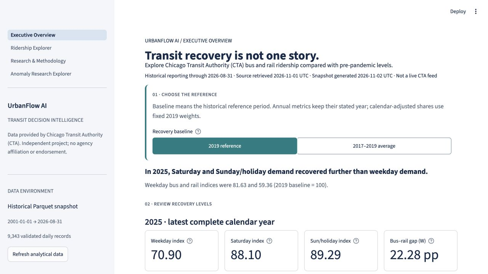

# UrbanFlow AI — Intelligent Urban Mobility Analytics Platform

UrbanFlow AI turns Chicago Transit Authority (CTA) daily bus and rail boardings
into reproducible research and an interactive decision-support dashboard.
A systemwide ridership total can hide differences in weekday, weekend, and
mode recovery. The project helps analysts compare consistent periods, inspect
data quality, and identify questions for deeper operational investigation.

The implementation connects validated ingestion, transactional PostgreSQL storage,
SQL and Python analytics, and a four-page Streamlit application. A versioned
historical snapshot lets users explore the dashboard without a database or live
API connection. Statistical anomaly research is experimental; an AI investigation
assistant is planned.

## Key Research Findings

- **Recovery differs by service day type.** In 2025, total recovery indices were
  **70.90 for weekdays, 88.10 for Saturdays, and 89.29 for Sundays/holidays**,
  relative to comparable 2019 periods set to 100.
- **Weekday bus recovery exceeds rail recovery.** The 2025 indices were
  **81.63 for bus and 59.36 for rail**, a **22.28 percentage-point gap**.
  Bus exceeded rail in all **56 weekday monthly comparisons** from January 2022
  through August 2026.
- **The bus share increase persists under fixed calendar weights.** Comparing
  January–August in both years, standardized bus share increased from
  **51.88% in 2019 to 58.98% in 2026**, a **7.09 percentage-point increase**.

Recovery indices compare each mode's monthly daily mean with the same month and
CTA day type in 2019. The 2025 summaries give all twelve monthly indices equal
weight; they are not annual-total ratios. Standardized shares use fixed 2019
month/day-type day counts for the matched January–August window. Differences are
calculated before rounding. CTA's Sunday/holiday category includes holidays on
weekdays. These are observational findings, not evidence of modal substitution
or other causal effects.

See the [research report](docs/insight_report.md) for baseline sensitivity,
methods, supporting exhibits, and planning implications.

## Interactive Dashboard

The locally runnable application contains four implemented pages:

- **Executive Overview:** compare recovery metrics, historical trends, and
  bus/rail differences; inspect supporting evidence and interpretation limits.
- **Ridership Explorer:** filter dates, CTA day types, modes, and comparison
  years; explore trends, year-over-year changes, seasonality, and recovery;
  download the analytical series used by the charts.
- **Research & Methodology:** inspect provenance, coverage, quality controls,
  metric definitions, limitations, and reproduction instructions.
- **Anomaly Research Explorer — experimental, read only:** inspect frozen
  historical actual-versus-expected values, statistical candidates, case evidence,
  model-health warnings, and research exports. Models are not fitted or recalibrated
  during page use.

The application uses a historical snapshot by default and is not publicly deployed.

**Live demo:** Pending first deployment. The verified Streamlit Community Cloud
URL will be added here after release.
<!-- LIVE_DEMO_URL: Populate only after a verified public deployment. -->



Current local release screenshots: [Executive Overview](docs/figures/release_overview.jpg)
and [Anomaly Research Explorer](docs/figures/release_anomaly_research.jpg).
These are local application captures, not evidence of a deployed service.

## Features & Technology Stack

**Implemented**

- Historical CTA ingestion with paginated date-range loading and a dedicated
  full-history backfill with bounded retries.
- Typed record validation, duplicate detection, coverage audits, and explicit
  quarantine of rejected historical records.
- Transactional PostgreSQL upserts with idempotent handling of unchanged records.
- Versioned archives and analytical Parquet bundles with checksums and provenance.
- SQL and Python research covering matched-period recovery, baseline sensitivity,
  fixed-calendar weighting, and time-series resampling sensitivity.
- Interactive Streamlit pages, Plotly charts, and analytical exports.

**Experimental**

Retrospective statistical anomaly detection compares calendar-median and
seasonal/trend models using past-only observations and chronological evaluation.
The repository includes predictions, evaluation summaries, candidate records, and
an input/code manifest in [the anomaly research artifacts](data/anomaly/cta-4c1a-v1).
Candidates are investigation leads, not confirmed incidents. The fourth page
exposes frozen, validated research artifacts through a separate read-only data
access layer. It does not train models, issue operational alerts, or provide
future forecasts. **Operational Readiness: NO-GO.** Historical periods were already
inspected; no independent prospective validation has occurred. Cases remain
unreviewed and causes unknown.

**Planned**

An evidence-grounded AI investigation assistant, forecasting and change point
detection, public deployment, and automation. These are not current capabilities.

**Technology:** Python 3.11+, PostgreSQL, psycopg 3, DuckDB, pandas, NumPy,
PyArrow/Parquet, Plotly, Streamlit, and pytest.

## System Architecture

The data flow is:

**CTA API → Validation → PostgreSQL / Historical Archive → SQL and Python
Analytics → Versioned Parquet Bundle → Streamlit**

- **Ingestion and persistence:** `ingestion.py` and `history.py` retrieve source
  records; `processing.py` validates them; `database.py` owns database writes.
  The historical workflow archives raw responses, quarantine records, validated
  database readback, and provenance.
- **Research and serving data:** versioned SQL and `research.py` define analytical
  calculations. `dashboard_data.py` builds and verifies six-table bundles.
- **Presentation:** `streamlit_app.py` routes to `app_pages/`; shared view models
  and Plotly rendering keep metric calculations outside page presentation code.
- **Research interface:** frozen predictions → validation → investigation and
  model-health artifacts → integrity-checked research loader → pure filters and
  view models → the experimental fourth page and its CSV/ZIP exports. Streamlit
  never fits or recalibrates the detector.

The default dashboard reads the bundled Parquet files without calling CTA.
An explicit PostgreSQL backend provides read-only consistent queries and does
not silently fall back to the snapshot when database access fails.

## Quick Start

Use Python 3.11 for the validated V1 environment. From a checkout containing the
versioned data, open a terminal at the repository root:

```sh
python3.11 -m venv .venv
source .venv/bin/activate
python -m pip install -r requirements.txt
python -m streamlit run streamlit_app.py
```

On Windows, activate the environment with `.venv\Scripts\Activate.ps1` in
PowerShell instead. Open the local URL printed by Streamlit.

The default bundle is `data/dashboard/cta-2026-11-01-v2`. It contains **9,343
validated daily records**, covering **January 1, 2001–August 31, 2026**, with the
July 2012 gap described below. PostgreSQL, API credentials, and a `.env` file
are not required for this workflow.

`pyproject.toml` defines the package and dependency compatibility ranges.
`requirements.txt` installs that project with the validated V1 versions in
`constraints.txt`, including Streamlit 1.66.1. Install from the repository root;
the application requires the checked-in snapshots and research artifacts.
See the [development guide](docs/dashboard_development.md)
for PostgreSQL configuration, backend selection, and pipeline commands.

## Testing & Reproducibility

Install the optional test dependencies, then run the offline suite:

```sh
python -m pip install -c constraints.txt -e '.[test]'
python -m pytest -m 'not integration'
```

Tests cover validation, ingestion failures, analytics, filtering, snapshot
integrity, and Streamlit page behavior. They use fixtures, mocks, and versioned
local data without live CTA requests. Streamlit AppTest checks application
state and output; it does not establish browser layout or accessibility quality.

PostgreSQL integration tests are optional. Configure a separate disposable
database with a role allowed to create schemas:

```sh
export TEST_DATABASE_URL=postgresql:///urbanflow_ai_test
python -m pytest -m integration
```

Integration tests skip when that variable is absent; a configured but unavailable
server fails rather than silently skipping. They check real database behavior,
including upserts, constraints, and rollback. No current test count is asserted here.

Reproduce the historical research offline from the validated archive:

```sh
python -m urbanflow_ai.research \
  --snapshot data/history/cta-2026-11-01-v1 \
  --output /tmp/urbanflow-research-reproduction
```

Choose a new output directory for each run. The research checks its input Parquet
checksum; dashboard loading verifies table checksums, analytical definition
hashes, schema, provenance, and coverage. These checks detect inconsistent
artifacts, not inaccuracies in CTA's original measurements.

See the [research execution notes](docs/research_walkthrough.md) and
[dashboard development guide](docs/dashboard_development.md) for snapshot export,
SQL parity checks, plotting, and debugging.

## Data Source and Public Use

Data provided by Chicago Transit Authority (CTA), published as
[Daily Boarding Totals on the Chicago Data Portal](https://data.cityofchicago.org/Transportation/CTA-Ridership-Daily-Boarding-Totals/6iiy-9s97).
The archived source was retrieved on November 1, 2026; validated observations end
on August 31, 2026. Derived analytical snapshots retain their own generation dates.
The project supports reproducible transit-demand research and planning discussion.

The portal identifies the license as “See Terms of Use”; consult the
[CTA data agreement](https://data.cityofchicago.org/api/assets/F1D239A9-B082-4C11-9F6F-2E637985FA5C)
and [source and release notes](docs/data_source_notice.md). This project is
independent and is not affiliated with or endorsed by CTA. Historical source data
is not represented as live, guaranteed accurate, or freely relicensed by this project.

## Limitations

- **Historical data:** the default snapshot ends on August 31, 2026. Refreshing
  cached application data does not retrieve new CTA records.
- **Measurement grain:** boardings count rides, not unique riders. The dataset
  has system-level daily totals, without route, station, or time-of-day detail.
- **July 2012 quarantine:** 31 source rows have non-midnight timestamps and fail
  the existing parser contract. They are retained for review and excluded from
  validated analysis; missing dates are never filled with zeros.
- **Incomplete periods:** 2012 has a validated-data gap and 2026 is partial.
  Complete-period rules suppress unsupported comparisons; a partial year must
  not be interpreted as a full-year recovery result.
- **Interpretation:** the data alone cannot isolate service supply, remote work,
  weather, events, or rider behavior as causes. Anomaly candidates require
  investigation and are not automatic evidence of source errors or incidents.
- **Experimental model health:** structural changes, residual calibration and
  sustained model failures limit anomaly interpretation. Clear research health
  does not override the operational NO-GO decision.
- **Release validation:** local checks do not certify every browser, assistive
  technology, Python version or cloud runtime. Remaining accessibility and
  deployment evidence gaps are recorded in the release preflight report.

## Development Roadmap

- Continue human investigation and prospective validation before considering any
  operational anomaly integration. The historical research interface already exists.
- Build an evidence-grounded AI investigation assistant with traceable source
  records, explicit metric definitions, and numerical calculations in SQL/Python.
- Evaluate forecasting and change point detection with chronological backtesting.
- Complete the first public hosting release, further assistive-technology testing,
  and later evaluate data refresh with provenance and validation safeguards.

## Technical Documentation

- [Research findings, definitions, and analytical limitations](docs/insight_report.md)
- [Research execution flow and debugging exercises](docs/research_walkthrough.md)
- [Dashboard metric and view specification](docs/dashboard_spec.md)
- [Development, pipeline, database, and reproduction guide](docs/dashboard_development.md)
- [Archived source and validation provenance](data/history/cta-2026-11-01-v1/manifest.json)
- [Default dashboard bundle manifest](data/dashboard/cta-2026-11-01-v2/manifest.json)
- [Experimental research interface acceptance](docs/anomaly_research_acceptance_gate.md)
- [Cross-page product QA evidence](docs/milestone_4b3b_product_qa.md)
- [Deployment preflight and local release validation](docs/release_preflight.md)
